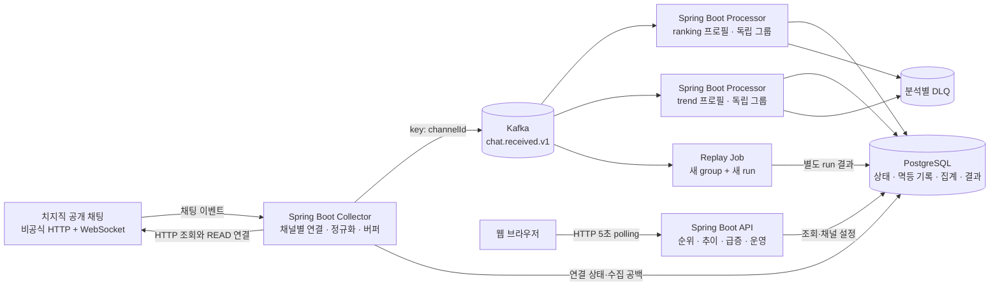

# Chat Pulse — 전체 아키텍처

2026-10-25 · v0.2 · 기술 기준: Spring Boot + Apache Kafka + PostgreSQL

## 1. 시스템 개요



Kafka 이전은 외부 데이터 수신 영역이고 이후는 내부 재처리 가능 영역이다. 외부에서 수신하지 못한 채팅은 이 구조만으로 복원할 수 없다.

## 2. 실행 단위와 책임

| 실행 단위 | 책임 | 실패 시 영향 |
|---|---|---|
| collector-app | HTTP 조회, READ WebSocket, 메시지 필터, eventId 부여, Kafka 발행, 연결 상태 기록 | 새 데이터 수집 중단. 이미 Kafka에 들어간 데이터는 분석 가능 |
| processor-app: ranking | 채팅 bucket 집계, 순위 snapshot 생성 | 순위·추이가 지연됨. trend 그룹은 독립 소비 |
| processor-app: trend | 별도 bucket 집계, 급증 판단·이력 저장 | 급증 판단 지연. ranking 그룹은 독립 소비 |
| api-app | 조회 API, 관리자 채널 설정 | 화면 중단. 수집·분석은 계속 가능 |
| processor-app: replay | DB의 QUEUED 작업을 가져와 지정 offsets 범위를 새 run으로 재집계 | 운영 run에 영향을 주지 않아야 함 |

같은 processor 코드의 프로필로 역할을 나눈다. Kafka가 독립 소비를 제공하지만 DB와 머신 자원은 공유하므로 완전한 장애 격리는 아니다. 소비자별 DB 풀·동시성을 제한하고 전체 DB 장애에서는 두 분석기가 모두 멈춘다.

MVP collector는 단일 호스트의 단일 인스턴스만 실행한다. 같은 호스트의 실행은 공유 lock 파일의 OS 파일 잠금으로 차단하며, 잠금을 얻지 못하면 시작을 거부한다. 컨테이너도 같은 lock volume을 공유한다. 다른 호스트에 중복 배포하는 구성은 지원하지 않는다. 두 수집기가 같은 채널에 연결하면 원천 이벤트가 이중 수집될 수 있다. 수평 수집 확장은 lease·fencing·담당 채널 분배 설계 후 추가한다.

## 3. 저장소와 모듈

```text
jigeumini/
  server/
    src/main/java/io/chatpulse/poc/       # 익명 수집
    src/main/java/io/chatpulse/pipeline/  # 발행·소비·집계·조회
    src/main/resources/db/migration/     # Flyway
    src/test/                            # 서버·broker/DB 검증
  web/
    src/app/                             # 공통 레이아웃과 경로
    src/features/                        # 방송 탐색·관심·상세
    src/shared/                          # API 계약·공통 UI
    design-preview/                      # 확정 디자인 원본
  scripts/                               # 설치·실행·검증
  docs/
  compose.yaml                           # 로컬 Kafka·PostgreSQL
```

2026-10-25 사용자 확정에 따라 서버와 웹을 우선 분리한다. 수집기·분석기는 현재 하나의 Spring 코드에서 프로필로 실행하며 논리 책임이 커질 때만 Gradle 모듈을 세분화한다. 구현·빌드 경계와 Git Flow는 [개발 구조](../DEVELOPMENT.md)를 따른다.

## 4. 기술 선택

| 영역 | 선택 | 이유 |
|---|---|---|
| 언어/런타임 | Java 21 초기 기준, Spring Boot | 사용자 희망 스택, HTTP·Kafka·운영 도구 통합 |
| 외부 HTTP | RestClient | 초기 소수 채널 조회. 수신 루프와 별도 실행기로 관리 |
| 외부 채팅 | StandardWebSocketClient 등 일반 WebSocket 클라이언트 | 확인한 비공식 경로는 JSON 프로토콜. STOMP·공식 Socket.IO와 다름 |
| 직렬화 | Jackson, versioned JSON | PoC와 이벤트 디버깅 단순화 |
| 이벤트 저장/전달 | Spring Kafka | 독립 소비 그룹, broker 확인, 재처리 |
| DB | PostgreSQL + Spring JDBC | bucket UPSERT와 멱등 트랜잭션을 명시적으로 제어 |
| 스키마 관리 | Flyway | 로컬 환경과 시험 환경의 재현성 |
| 사용자 화면 | React + TypeScript + Vite | 확정 디자인을 기능별 웹으로 구현, 서버와 HTTP 경계 유지 |
| 관측 | Actuator + Micrometer | 앱 지표. 필요 시 Prometheus/Grafana를 선택 프로필로 실행 |
| 통합 검증 | JUnit + Testcontainers | 실제 Kafka/PostgreSQL commit·재전달 동작 확인 |

Java 21 및 라이브러리 조합은 착수 시 공식 호환표로 확인한다. 최신 버전을 임의 혼합하지 않고 Spring Boot BOM을 따른다.

## 5. Kafka 구성

| 토픽 | key | 파티션 초안 | 보존 초안 | 목적 |
|---|---|---:|---|---|
| chat.received.v1 | channelId | 6 | 24시간, 파티션별 용량 제한 병행 | 정규화된 일반 채팅 발생 이벤트 |
| chat.ranking.dlq.v1 | 원본 topic/partition/offset | 3 | 7일, 용량 제한 | ranking 처리 불가 이벤트 |
| chat.trend.dlq.v1 | 원본 topic/partition/offset | 3 | 7일, 용량 제한 | trend 처리 불가 이벤트 |

- 소비 그룹: `chat-ranking-v1`, `chat-trend-v1`, `chat-replay-{runId}`.
- 동일 채널은 동일 파티션으로 보낸다. 이는 발행 순서를 유지할 뿐 이벤트 발생 시각의 정렬을 보장하지 않는다.
- 소비자 병렬성은 파티션 수의 제한을 받는다. 인기 방송 한 곳이 병목이면 파티션 수 증가만으로 해결되지 않는다.
- producer `acks=all`, idempotence 활성화. Kafka client 기본 호환 조건을 지키고 명시적 설정을 검증한다.
- 초기 운영 중 파티션 수 변경은 채널의 key 매핑을 바꿀 수 있다. 필요하면 수집을 정지·배출하고 새 토픽으로 전환한다.
- 크기 제한이 시간 제한보다 먼저 작동할 수 있다. **24시간 보존을 절대 보장하지 않고** 실제 earliest offsets로 재처리 가능 범위를 판단한다.

## 6. PostgreSQL의 역할

1. 관리 정보: 등록 채널, 수집 실행, 연결 세션, 공백, collector heartbeat.
2. 분석 데이터: projection/run별 처리 완료 eventId와 10초 bucket.
3. 제품 결과: 순위 snapshot, 사후 품질 정정, 급증 상태·이력.
4. 작업 정보: replay 범위·상태·검증 결과.

채팅 원문 전체를 DB에 복제하지 않는다. 분석 입력은 Kafka에 단기 보관하고 DB에는 필요한 필드와 집계 결과만 남긴다. 중복 방지 ledger의 저장량은 별도로 측정한다.

## 7. 배포 구상

### 개발 프로필

- 애플리케이션: collector 1, ranking 1, trend 1, api 1.
- Kafka: KRaft 단일 broker, replication factor 1, min ISR 1.
- PostgreSQL: 단일 인스턴스.
- Docker Compose와 영속 volume 사용. 단일 broker 구성으로 broker 장애 내구성을 주장하지 않는다.
- 관리자 접근은 로컬에서만 시작한다. 공개 배포는 별도 요청과 설정 검토 이후다.

### 복구 실험 프로필

- Kafka 3 broker/controller, replication factor 3, min ISR 2, acks=all.
- 한 broker 중지와 소비자 중지/재시작 실험을 구분한다.
- 같은 머신에서 실행하면 머신·디스크 장애는 공통 장애다. 운영 고가용성 검증으로 표현하지 않는다.
- PostgreSQL은 단일 DB로 유지하므로 DB 장애 실험은 복구 시 재처리와 중복 방지 확인에 한정한다.

## 8. 이 프로젝트에서 Kafka의 필요성과 한계

채팅 수집 데이터를 ranking/trend 두 소비자가 독립적으로 처리하고, 소비자 중단 중 입력을 보관하며, 로직 변경 후 같은 입력으로 다시 계산한다. 이 세 가지를 구현·실험하는 것이 채택 이유다.

20개 채널이나 개인 프로젝트라는 이유만으로 Kafka가 필수는 아니다. 단순 카운터 서비스면 DB 직접 저장이 더 간단하다. 또한 Kafka는 외부 연결 실패, upstream 중복, 단일 DB 병목을 자동 해결하지 않는다.

## 9. 설계 결정 기록

| ID | 결정 | 대안과 트레이드오프 |
|---|---|---|
| ADR-01 | 비공식 어댑터를 교체 가능하게 분리 | 공식 API는 협력 채널 인증이 필요. M0 실패 시 채택 재검토 |
| ADR-02 | 독립 소비 그룹 2개 | 같은 입력 계산이 일부 중복되지만 분석기별 중지·확장·재처리가 가능 |
| ADR-03 | DB ledger와 집계를 같은 트랜잭션으로 처리 | 저장 비용이 증가하지만 내부 이벤트 재처리 시 중복 반영 방지 |
| ADR-04 | 메모리 bounded buffer로 MVP 시작 | 구현이 간단하나 수집기 종료 시 미발행 데이터 손실 가능. 무손실 요구가 생기면 durable spool 별도 설계 |
| ADR-05 | 10초 bucket + Postgres snapshot | Kafka Streams 없이 구현 가능. 더 높은 지속 처리량에는 DB 비용 재평가 |
| ADR-06 | 원문·작성자 식별정보 제외 | 키워드·고유 참여자 분석 불가. 채팅량·급증 검증에 집중 |
| ADR-07 | 외부 알림 대신 DB 급증 피드 | 알림 송신의 이중 반영과 outbox를 MVP에서 피한다. 외부 알림 추가 시 outbox 도입 검토 |
| ADR-08 | poll 배치 전체 성공 후 offset 진행 | DB/DLQ 실패 시 전체 배치를 재시도하고 ledger로 중복을 방지. 부분 ack의 복잡성을 줄임 |
| ADR-09 | MVP DLQ는 격리·진단, 수정 검증은 새 replay run | 운영 재투입은 제외. 별도 retry 토픽·오래된 입력 중복 방지 정책이 필요하면 후속 설계 |

세부 처리 계약과 시험 시나리오는 [HLD](HLD.md), 제품 정책은 [PRD](PRD.md)를 따른다.
