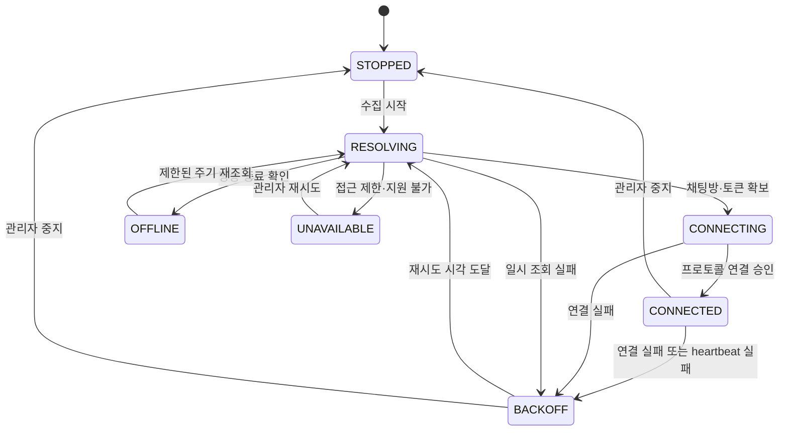
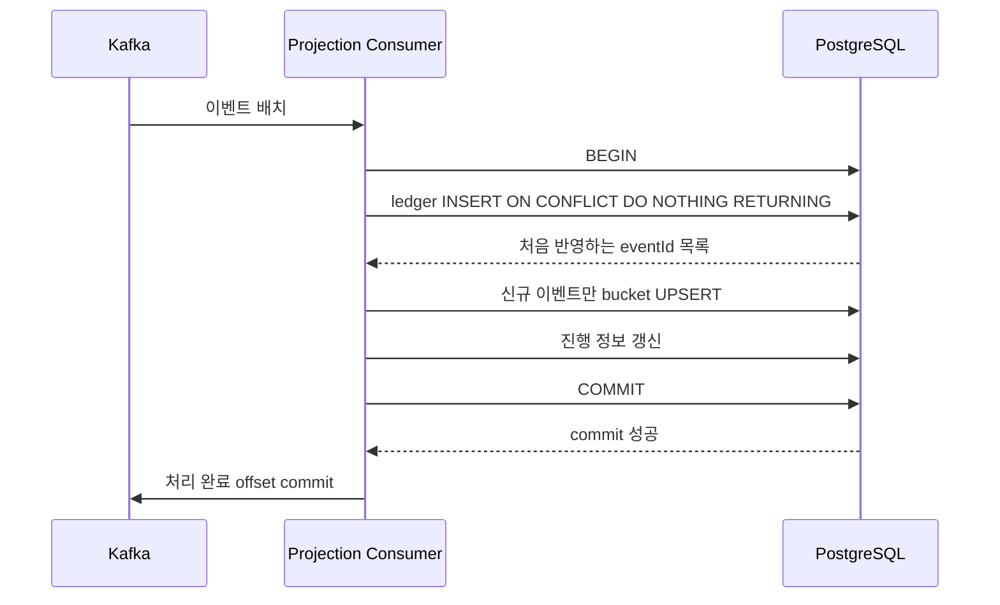

# 지금이니 — High-Level Design

2026-10-25 · v0.2 · 구현 전 설계

## 1. 설계 범위와 보장

PRD의 P0 요구사항을 Spring Boot, Kafka, PostgreSQL로 구현한다. 수집 어댑터가 외부 프로토콜을 숨기고, Kafka 이벤트가 분석기의 입력 계약이 된다.

| 경계 | 설계상 보장 | 보장하지 않는 것 |
|---|---|---|
| 치지직 → 수집기 | 접속 상태·수신 이벤트 관측, 제한된 재시도 | 모든 원천 채팅 수신, 접속 중단 중 완전한 복원 |
| 수집기 → Kafka | 같은 버퍼 이벤트 재시도 시 eventId 유지, publish ack 확인 | 메모리 버퍼 상태에서 프로세스/머신 종료 시 무손실 |
| Kafka → PostgreSQL | at-least-once 소비 + 내부 eventId별 멱등 DB 반영 | Kafka와 DB의 하나의 분산 트랜잭션 |
| DB → 화면 | snapshot 단위 일관된 순위, 기준 시각·상태 표시 | 소스 전체의 정확한 실시간 채팅 총량 |

Spring Kafka의 트랜잭션 동기화는 DB와 Kafka의 두 commit 사이 실패를 없애주지 않는다. 이 설계는 DB ledger와 집계를 원자적으로 반영하고 그 뒤 offset을 진행한다. [Spring Kafka 트랜잭션](https://docs.spring.io/spring-kafka/reference/kafka/transactions.html)

## 2. 주요 모듈 인터페이스

| 모듈 | 개념적 인터페이스 | 소유할 책임 |
|---|---|---|
| ChannelRegistry | listEnabled(), enable(), disable() | 대상 채널·설정 버전 |
| ChatSourceAdapter | resolveRoom(), issueReadToken(), connectReadOnly() | 비공식 HTTP/WebSocket, source frame 해석 |
| ConnectionSupervisor | start(channel), stop(channel), onFailure() | 상태 전이·heartbeat·재시도 |
| EventNormalizer | normalize(frame, context) | CHAT 분류, 시각 검증, 내부 ID, 개인정보 제거 |
| EventPublisher | enqueue(event), publishBatch() | bounded buffer·publish ack·동일 ID 재시도 |
| ProjectionHandler | apply(event, projection, run) | ledger + bucket 트랜잭션 |
| RankingEvaluator | snapshot(T, window) | 커버리지 필터·순위·이전 snapshot 비교 |
| TrendEvaluator | evaluate(T, algorithmVersion) | 기준선·연속 충족·cooldown·피드 |
| ReplayRunner | start(manifest), cancel(run) | 고정 offset 범위·격리 결과·비교 |

인터페이스는 설계 설명용이며 그대로 클래스 수를 고정하지 않는다. 외부 HTTP 호출·재접속을 WebSocket callback 안에서 오래 실행하지 않는다.

## 3. 수집 상태와 데이터 경계

### 3.1 연결 상태



- backoff 초안: 1/2/4/8/16/30초 상한 + ±20% jitter. 반복 실패 후 채널을 degraded로 표시한다. 실제 요청 제한에 맞춰 M0에서 조정한다.
- 채팅방 ID 변경 여부를 초기 30초 주기로 확인하되, HTTP 호출은 공통 rate limiter를 거친다. 문서화되지 않은 한도를 추측해 우회하지 않는다.
- 20초 간격 heartbeat, 10초 응답 제한을 초기 후보로 검증한다. 플랫폼 규칙과 충돌하면 소스 어댑터 설정을 조정한다.
- 조용한 방송도 heartbeat 응답이 정상일 수 있다. 마지막 채팅 시각만으로 끊김을 판단하지 않는다.
- collector heartbeat는 DB에 5초 간격으로 기록한다. 15초 이상 사라지면 마지막 확인 heartbeat 이후를 unknown으로 처리한다. collector 생존과 소스 연결 생존을 구분해 세션에 last_source_alive_at도 기록한다. 열린 세션은 collector heartbeat가 15초 미만이고 소스 frame/pong 확인이 30초 미만인 동안 현재까지 잠정 정상으로 추정한다. timeout 시 마지막 성공 확인 이후부터 gap으로 정정한다. 따라서 커버리지는 관측 기반 추정치다.
- WS close, parse 실패로 인한 유실, buffer 초과, publish 포기로 구간별 gap을 기록한다. DB에도 기록할 수 없던 장애는 heartbeat timeout으로 넓게 unknown 처리한다.

채널 설정은 5초마다 읽는다. disable 시 신규 연결·재연결을 취소하고 소켓을 닫으며, 이미 접수한 이벤트만 drain한다. callback에 session generation을 연결해 종료한 연결의 늦은 callback은 버린다. 비활성 채널은 새 순위 대상에서 즉시 제외한다. 제목 조회 실패는 채널 ID로 대체하며 채팅 수집 실패로 간주하지 않는다.

### 3.2 버퍼와 실패

- 초기 한도: 전역 10,000개 및 추정 직렬화 크기 32MiB 중 먼저 도달하는 값. 채널별 1,000개 상한으로 한 방송이 전부 점유하지 않게 한다. JVM 객체 메모리는 별도 측정한다.
- publish 중 이벤트도 확인될 때까지 한도에 포함한다. 결과 불명 상태의 재시도에는 같은 eventId를 사용한다.
- 채널 내 순서를 보존하는 발행 경로를 사용한다. 실패한 앞선 이벤트를 제멋대로 뒤로 보내지 않는다.
- 한도 초과 시 새 이벤트를 거절하고 dropped counter와 gap을 기록한다. 조용히 성공으로 간주하지 않는다.
- Kafka 장기 장애 시 수집을 계속 유지해 무한 적체시키지 않는다. 한도 도달 채널은 연결을 닫고 unavailable/degraded 상태에서 backoff한다.
- 종료 시 최대 10초 drain을 시도하고 미확인 건수를 기록한다. 강제 종료는 그 기록마저 남기지 못할 수 있으므로 heartbeat와 함께 판단한다.
- 디스크 spool은 MVP 제외다. 이를 추가하기 전에는 수집기 재시작 전후의 무손실 수집을 주장하지 않는다.

## 4. 이벤트 계약

### 4.1 `chat.received.v1`

```json
{
  "schemaVersion": 1,
  "eventId": "5d4b1864-e43d-45ee-8b03-2f7ba44c989b",
  "source": "CHZZK_UNOFFICIAL",
  "channelId": "example-channel",
  "chatRoomId": "example-room",
  "collectionSessionId": "d97bca2f-1ad7-4d43-bccf-758c9627c4cb",
  "sourceMessageId": null,
  "eventType": "CHAT",
  "eventTime": "2026-10-25T03:00:01.120Z",
  "receivedAt": "2026-10-25T03:00:01.230Z",
  "isHistorical": false,
  "collectorVersion": "0.1.0"
}
```

- 토픽 key는 channelId다. 한 WS frame에 여러 메시지가 있으면 개별 메시지로 분리한다.
- eventId는 처음 정규화할 때 생성하는 UUID다. 내부 publish retry와 원본 replay에 보존한다.
- Kafka record timestamp는 receivedAt으로 명시한다. broker의 timestamp 정책도 CreateTime으로 맞추고 확인한다.
- sourceMessageId는 실제 플랫폼 고유 ID를 확인한 경우에만 채운다. 없다면 null이다. 최초 MVP의 중복 제거 기준은 내부 eventId다.
- 동일 원천 메시지를 소스가 다시 보내면 새 eventId가 생길 수 있다. 별도 고유 ID 검증 없이는 이를 제거했다고 주장하지 않는다. 내용+시각 해시는 정상 반복 채팅을 지울 수 있어 기본으로 사용하지 않는다.
- eventTime은 소스의 발생 시각이다. 없거나 유효하지 않으면 receivedAt으로 조용히 치환하지 않고 격리한다. 미래 시각이 receivedAt보다 5초 초과이면 격리하는 초기 규칙을 둔다.
- receivedAt보다 120초 이상 과거인 이벤트는 late로 계수한다. eventTime이 현재 기준 최근 7일 이내이면 과거 bucket에 반영하지만 현재 급증 피드를 소급 생성하지 않는다.
- eventTime이 현재 기준 7일보다 오래된 live 입력은 보존 범위 밖으로 격리한다. replay는 manifest의 시각 범위로 처리하며 live의 현재 시각 기반 보존 필터를 적용하지 않는다.
- `isHistorical=true`는 MVP live 입력에서 제외한다. 최근 이력을 실시간으로 재분류하지 않는다.
- 원문·닉네임·사용자 ID는 제외한다. transport frame 파싱 후 필요한 필드만 취한다.
- 허용 크기 초기값은 정규화 이벤트 16KiB, transport frame 1MiB다. 실제 배치 크기 확인 후 조정하며 초과는 계수·격리한다.
- 추가 optional 필드는 허용한다. 필수 필드/의미를 깨는 변경은 새 토픽 major version과 호환 계획을 필요로 한다.

### 4.2 실패 이벤트

DLQ envelope와 확정한 오류 격리 정책은 [M3 DLQ 계약](../pipeline/DLQ.md)을 따른다. failureId는 원본 topic ID/partition/offset으로 결정하며 projection별 중복은 DB namespace로 구분한다. 원본 bytes/key/headers·예외 본문·원문 hash는 저장하지 않는다. 허용된 코드·좌표·품질 영향 범위만 기록한다.

## 5. PostgreSQL 논리 모델

| 테이블 | 주요 키/필드 | 책임 |
|---|---|---|
| channel | PK channel_id, display_name, enabled, source, metadata_updated_at | 수집 대상과 표시 정보 |
| collection_session | PK session_id, channel_id, chat_room_id, connected_at, last_heartbeat_at, last_source_alive_at, ended_at, end_reason | 연결 정상 시간과 종료 상태 |
| collection_gap | PK gap_id, channel_id, start_at, end_at?, reason, known_dropped_count? | 누락·불명 구간 |
| collector_heartbeat | PK collector_id, heartbeat_at, status | 비정상 종료 탐지 |
| processed_event | PK(projection, run_id, event_id), received_at, processed_at, source_position, payload_hash | DB 멱등 처리 ledger |
| chat_bucket_10s | PK(projection, run_id, channel_id, bucket_start), chat_count | 독립 분석별 이벤트 시각 집계 |
| projection_progress | PK(projection, run_id, topic, partition), next_resolved_offset, checked_at | 진행·freshness 관측, offset commit의 대체가 아님 |
| projection_observation | PK(projection, topic, partition), observed_end_offset, observed_at, last_caught_up_at, poll_heartbeat_at | 분석 freshness |
| collector_channel_buffer | PK(channel_id), oldest_unacked_received_at?, buffer_count, observed_at | Kafka 이전 적체 |
| ranking_snapshot | PK snapshot_id, run_id, window_sec, evaluated_at, created_at, algorithm_version, UNIQUE(run_id, window_sec, evaluated_at, algorithm_version) | 일관된 순위 헤더 |
| ranking_entry | PK(snapshot_id, channel_id), rank, count, previous_rank?, coverage, status | snapshot별 순위 |
| snapshot_quality_revision | PK(snapshot_id, channel_id), reason, revised_at | 사후 발견한 공백·격리 오류의 품질 하향 정정 |
| channel_alert_state | PK(run_id, channel_id, algorithm_version), last_evaluated_at, consecutive_hits, last_alert_at | 연속 조건·cooldown |
| spike_event | PK spike_id, UNIQUE(run_id, channel_id, evaluated_at, algorithm_version), count, baseline, ratio | 사용자 급증 피드 |
| replay_run | PK run_id, manifest_json, state, created_at, started_at, heartbeat_at, worker_id, completed_at, algorithm_version, result_json | 고정 입력 재처리 작업 |

- run_id=`live-v1`은 운영 분석이다. replay UUID는 다른 공간을 사용한다.
- bucket_start는 UTC epoch 기준 10초 내림이다. count는 bigint, 시각은 timestamptz를 사용한다.
- 인덱스 후보: bucket의 `(projection, run_id, bucket_start, channel_id)`, spike의 `(run_id, evaluated_at DESC)`, gap/session의 `(channel_id, start/connected_at)`.
- 자주 갱신되는 bucket을 per-event로 UPDATE하면 row lock·WAL이 병목이 될 수 있다. 미니배치별 신규 eventId만 집계해 채널/bucket별 합산 UPSERT한다.
- ledger가 크므로 측정 전 무분별하게 보조 인덱스를 추가하지 않는다. 시간 partition 도입 시 PK 전역 유일성 제약이 달라질 수 있어 별도 설계한다.

### 보존 정책 초안

| 데이터 | 초기 보존 |
|---|---|
| Kafka 일반 이벤트 | 최대 시간 24시간 + 크기 한도; 실제 재처리 가능 범위는 offsets로 확인 |
| processed_event | 기본 72시간, 소비 지연·DLQ·작업 상태 확인 후 정리 |
| 10초 bucket | 7일 |
| 순위 snapshot·급증·연결 상태 | 7일 |
| DLQ | 현재 개발 설정 24시간·partition당 256MiB, commit된 진단은 DB에 보존. 정리 정책은 별도 |
| 완료된 replay 결과 | 확인 후 7일, active run은 삭제하지 않음 |

ledger를 지운 뒤 오래된 입력을 운영 run에 다시 넣으면 중복될 수 있다. **MVP는 DLQ·관리자 입력을 live run으로 재투입하지 않는다.** live 소비자는 receivedAt이 현재보다 48시간 이상 과거인 입력을 격리한다. ledger 보존 나이는 processed_at 기준 72시간으로 계산한다. 보존기간을 넘긴 입력 검증은 새 replay run에서 처리한다. 정리 작업은 가장 오래된 pending offset/active job을 확인하고 필요한 ledger 삭제를 보류한다. 저장량이 한도를 넘으면 수집 규모를 줄이고 운영 상태를 알린다.

산정 예: 평균 이벤트 500 bytes, 지속 500/s를 24시간 유지하면 Kafka payload만 약 21.6GB이며 RF3이면 약 64.8GB다. 압축·인덱스·세그먼트 여유는 별도다. 2개 projection의 ledger는 하루 최대 8,640만 행이다. 따라서 **10분 부하 시험 통과를 상시 운영 용량으로 해석하지 않는다.** 실제 장기 입력량 기준으로 보존기간·저장 공간·처리 방식을 재결정한다.

## 6. DB 반영과 offset 처리



### 6.1 성공·실패 경계

- batch listener, `enable.auto.commit=false`, `AckMode.BATCH`로 고정한다. consumer thread에서 동기 처리하며, 별도 DB transactional service 호출이 commit까지 끝난 뒤 listener가 반환한다. 비동기 worker에서 ack하지 않는다.
- `ByteArrayDeserializer`로 받고 listener 안에서 계약 검증을 수행해, 파싱 불가 record도 위치를 식별해 격리할 수 있게 한다.
- poll 배치를 유효·영구 오류로 먼저 분류한다. historical 입력도 계약 위반으로 격리한다. 정상 ledger 처리와 DLQ ACK를 수행하고, bucket·진행 정보·격리 오류를 같은 DB 트랜잭션에 저장한다. 완전히 검증된 충돌의 채널/시간은 해당 구간을 불완전 처리한다. 나머지는 감지 시각 -7일~+5초의 전체 수집 범위를 불완전 처리한다. 이는 live 입력이 기여할 수 있는 시간 범위이며 해당 범위 밖 새 창에서도 정상 관측 조건을 다시 충족해야 한다. 상세 정책·한계는 M3 계약에 둔다.
- 모든 단계가 성공한 경우에만 listener가 정상 반환한다. 하나라도 실패하면 **poll 배치 전체를 재시도**한다. 부분 성공 offset commit은 MVP에서 사용하지 않는다. DLQ 중복은 failureId로 식별한다.
- ledger INSERT의 `ON CONFLICT DO NOTHING RETURNING` 결과에 포함된 신규 ID만 채널/bucket별 합산 UPSERT한다. batch 내부 ID도 먼저 중복 제거한다. 같은 eventId에 다른 핵심 필드(channelId/eventTime 등)가 들어오는 경우 입력 계약 위반으로 격리한다. 같은 배치 안에서 충돌하는 ID는 어느 payload도 임의 선택하지 않는다. 기존 ledger와 충돌하면 기존 집계를 유지하고 새 입력을 격리한다. 이를 검사할 정규화 payload hash를 ledger에 저장한다. [PostgreSQL INSERT](https://www.postgresql.org/docs/current/sql-insert.html)
- DB commit 전 실패는 rollback한다. DB commit 후 Kafka commit 전 실패는 재수신되지만 ledger로 중복 증가를 막는다. `next_resolved_offset`은 해당 파티션에서 유효 반영·명시 제외·DLQ 확인까지 끝난 마지막 연속 record offset + 1이다. 모든 record가 무효여도 진행 정보는 DB에 반영한다.
- 일시 DB/Kafka 장애는 무제한 재시도 대상으로 삼고, 기본 recoverer가 몇 회 후 로그만 남기고 건너뛰지 않게 한다. Spring Kafka batch fallback 재시도와 pause 중 poll 유지 동작을 고정 버전에서 통합 시험한다. 현재 구현은 미분류 실행 오류도 고정 코드로 표시하고 배치를 재시도한다. 자동 중지·관리자 재개는 후속 운영 정책이며 미완료 offset을 commit하지 않는다. [오류 처리](https://docs.spring.io/spring-kafka/reference/kafka/annotation-error-handling.html)

### 6.2 초기 설정과 제한

`max.poll.records=200`, `max.poll.interval.ms=300000`, container `pollTimeout=1000ms`, `fetch.max.wait.ms=100`을 초기값으로 둔다. 100ms는 broker fetch 대기 상한 설정이며, 정확히 100ms마다 200건을 모으는 앱 타이머가 아니다. **한 번 받은 poll 배치가 한 DB 트랜잭션 경계**다. consumer concurrency는 프로필당 1로 시작해 측정 후 늘린다.

DLQ 발행 ack 대기는 배치의 DB 처리 진입 기준 10초의 공통 기한을 사용하며 동기 send 진입은 max.block.ms=2000만큼 추가 지연될 수 있다. DB statement timeout은 5초다. 연결·lock·transaction에도 유한 timeout을 적용하고, 실패 시 listener 밖으로 고정 오류 코드를 전달한다. statement timeout만으로 전체 배치 소요 시간이 제한된다고 가정하지 않는다. 재시도 중 poll을 유지해 `max.poll.interval.ms`를 넘기지 않는지 장애 시험한다. 자동 offset 초기화는 `none`으로 두고, 최초 설치만 관리 절차로 명시한 start offset을 설정한다. retention 만료를 자동 latest 이동으로 숨기지 않는다.

ranking/trend는 서로 다른 ledger namespace를 사용한다. 설정과 예외 분류는 실제 채택할 Spring Kafka 버전에서 확인한다. [컨테이너 문서](https://docs.spring.io/spring-kafka/reference/kafka/receiving-messages/message-listener-container.html)

## 7. 집계와 조회 계약

### 7.1 순위 snapshot

- ranking evaluator는 10초마다 T를 기준으로 1분/5분 bucket을 합산한다. 커버리지 계산에서 여러 session을 합칠 때 겹친 시간을 중복 합산하지 않는다.
- gap과 heartbeat 불명 구간을 정상 연결 구간에서 제외한다. 커버리지가 95% 미만이거나 drop/분석 지연이 확인되면 기본 순위에서 제외한다.
- PostgreSQL REPEATABLE READ snapshot에서 순위 header/entries를 만들고 하나의 트랜잭션으로 저장한다. 같은 run/T/window/algorithm의 중복 생성은 unique 제약으로 막는다. 활성 채널 목록을 기준으로 bucket을 LEFT JOIN하므로 채팅이 없는 정상 채널도 0건으로 포함된다. 집계 row 부재만으로 정상 여부를 판단하지 않는다.
- 순위 변화의 이전 기준은 T−60초의 동일 window snapshot이다. 없거나 해당 채널의 품질이 불완전하면 null + 사유를 준다.
- evaluator는 역할별 1개 scheduler로 실행하고 매 평가 트랜잭션에서 역할·run별 pg_try_advisory_xact_lock을 얻은 경우만 계산한다. 잠금 실패 시 그 tick은 건너뛴다. 분석 consumer 확장과 scheduler 확장은 구분한다.

### 7.2 급증 감지

trend 자체 bucket으로 계산한다. C는 `[T−60초,T)` 합계, B는 `[T−360초,T−60초)` 합계 / 5이며, 소수점을 버리지 않는다. PRD의 세 임계값을 모두 적용한다.

channel_alert_state를 row lock으로 잠그고 동일/이전 T의 중복 평가를 무시한다. 직전 평가가 정확히 T−10초이고 정상·조건 충족인 경우에만 consecutive_hits를 이어간다. false, 품질 불량, 평가 누락은 0으로 초기화한다. 두 번째 충족 시 spike INSERT와 last_alert_at 갱신을 같은 DB transaction에서 처리한다. cooldown은 `T < last_alert_at + 300초`일 동안이며 그동안 consecutive_hits=0이다. 경계 도달 후 다시 두 번 연속 충족해야 한다. 지나간 tick은 재평가하지 않는다.

### 7.3 freshness와 품질 정정

freshness는 마지막 채팅 시각으로 계산하지 않는다. 각 projection의 observer가 5초마다 Kafka partition별 end offset을 조회한다. 직전 관측을 포함해 최근 3개 end-offset 표본을 유지하고 매 검사에서 DB 진행 위치와 비교한다. DB next_resolved_offset이 표본의 end offset 이상이면 해당 관측 시각을 `last_caught_up_at`으로 기록한다. 두 값은 모두 다음 offset 기준이다. 입력 없는 partition도 조건을 만족하므로 조용한 정상 방송을 지연으로 오판하지 않는다.

채널이 속한 partition의 last_caught_up_at이 10초 이내이며 consumer poll heartbeat가 15초 이내이면 분석 freshness를 통과한다. observer 장애·관측 부재는 unknown이다. 같은 partition에 다른 채널 적체가 있어도 보수적으로 함께 지연 처리한다. DB에 partition별 관측 시각/end offset/last_caught_up_at과 consumer heartbeat를 저장한다. 과거 관측을 뒤늦게 달성했다고 현재 시각으로 갱신하지 않는다.

Kafka에 아직 발행되지 않은 버퍼는 위 검사로 보이지 않는다. collector가 5초마다 채널별 oldest_unacked_received_at·buffer_count를 기록하고, 미확인 버퍼의 나이가 10초를 넘으면 해당 채널도 지연 처리한다. collector heartbeat가 끊기거나 이 지표 자체의 observed_at이 15초 이상 오래되면 unknown이다.

snapshot 생성 시 품질 판정은 다음 우선순위를 따른다. API는 대표 status와 전체 reasons를 함께 준다.

| 상태 | 기준 | 순위·차트 처리 |
|---|---|---|
| DISABLED / OFFLINE | 관리자 중지 / 방송 종료 확인 | 현재 순위 제외, 과거 추이 조회 가능 |
| INCOMPLETE | 알려진 손실·격리 오류 또는 전체 window의 커버리지 <95% | 수신 건수는 참고값, 정식 rank/count는 null |
| WARMING_UP | 시작 후 해당 window를 채우지 못함 | 순위 제외 |
| LAGGING / UNKNOWN | 버퍼·분석 지연 / 관측 부재 | 순위 제외, 마지막 갱신 시각 표시 |
| HEALTHY | 위 사유 없고 연결 커버리지 ≥95% | 0건 포함 정상 순위 |

전체 window를 관측했으나 커버리지 <95%이면 INCOMPLETE다. 일반 재접속 gap은 커버리지 계산에 반영하며, 95% 이상이어도 확인된 메시지 손실·격리 오류가 있으면 제외한다. source eventTime 집계와 receive-time 연결 상태는 같은 시계가 아니므로 커버리지는 원천 완전성의 증명이 아니다.

사후 heartbeat timeout 등으로 공백을 발견하면 겹치는 snapshot entry에 quality revision을 남긴다. 기존 건수·순위는 변경하지 않고 조회 시 ‘수집 불완전’으로 표시하며 순위 변화 비교 대상에서 제외한다. 이미 생성한 급증 기록도 유효성 경고를 붙인다. 늦은 이벤트의 bucket 보정만으로 과거 snapshot을 다시 계산하지 않는다.

### 7.4 HTTP API 초안

| 메서드/경로 | 결과 또는 동작 |
|---|---|
| GET /api/v1/rankings?window=60&limit=20 | 최신 snapshot, evaluatedAt, entries, excludedChannels, status |
| GET /api/v1/channels/{id}/activity?from=...&to=... | 최대 최근 1시간, 분별 count·coverage·gap |
| GET /api/v1/spikes?cursor=...&limit=20 | 최신 급증 피드, cursor 페이지네이션 |
| GET /api/v1/collection-status | 공개 요약: 정상/불완전 대상 수·갱신 시각 |
| PUT /api/v1/admin/channels/{id} | 관리자 채널 등록·enabled 변경; 목표 상태만 갱신 |
| POST /api/v1/admin/replays | 고정 manifest 검증 후 202 + runId |
| GET /api/v1/admin/replays/{runId} | 작업 상태·비교 결과 |
| POST /api/v1/admin/replays/{runId}/cancel | 대기/실행 작업 취소 요청 |

순위 API는 evaluatedAt이 현재보다 20초 이상 오래되면 STALE을 반환하고, 기존 결과에 기준 시각을 표시한다. 이 상태에서 최신 순위처럼 표시하지 않는다. 전체 API status와 채널별 수집 status는 별도 필드다.

조회 limit은 최대 100, window는 60/300만 허용한다. snapshot이 아직 없으면 status=WARMING_UP과 빈 결과를 반환하고 0건 순위를 만들어내지 않는다. DB 자체가 불가하면 503을 반환한다. admin은 Spring Security로 인증하며 초기에는 localhost에만 노출한다. 임의 Kafka topic/group 이름을 public API 입력으로 허용하지 않는다.

## 8. 실패 처리

| 실패 | 처리 | offset/결과 |
|---|---|---|
| 외부 HTTP/WS 일시 실패 | supervisor backoff, 채널/토큰 재확인 | 수집 gap. 보존 범위 내 Kafka 데이터는 분석 가능 |
| 접근 제한 방송 | UNAVAILABLE, 자동 우회 없음 | 해당 채널 제외 |
| Kafka 발행 실패 | 같은 ID로 제한된 retry, bounded buffer | ack 전 성공 취급 금지. 버퍼 소진 시 gap |
| PostgreSQL 일시 장애 | consumer partition pause/backoff, poll 유지 가능한 방식 | offset 미진행. 정상 복구 후 재처리 |
| 유효하지 않은 스키마/영구 변환 오류 | 공통 DLQ 발행·분석 namespace별 DB 격리 | DLQ publish 확인·DB commit 후에만 원본 offset 진행 |
| DLQ 전송 실패 | 해당 처리를 성공 처리하지 않고 재시도 | 원본 offset 미진행 |
| DB commit 직후 프로세스 종료 | 재수신 후 ledger 확인 | 같은 ID의 count 증가 없음 |
| Kafka retention 만료 | 진행 불가능한 offset을 감지하고 작업 실패 표시 | 조용히 latest로 넘어가 정상으로 표시하지 않음 |
| collector 중복 실행 | 단일 호스트의 공유 OS 파일 잠금; 잠금 획득 실패 시 시작 거부 | 자동 active-active 지원하지 않음 |

원본 offset commit과 DLQ publish는 두 동작이라 DLQ에 중복이 생길 수 있다. failureId로 운영 화면에서 합친다. MVP에서는 DLQ를 live 토픽으로 재투입하지 않는다. 오류 수정 검증은 원본 토픽의 보존된 범위를 새 run으로 replay하며 eventId를 유지한다. 원본이 만료되면 안전한 진단 envelope만으로 이벤트를 복원할 수 없으므로 복구 불가로 표시한다. 일시 DB 장애를 모든 메시지의 영구 오류로 취급해 DLQ로 흘리지 않는다.

## 9. 재처리 설계

1. 관리자가 분석 버전과 입력 범위를 선택한다. 관리 명령은 허용된 source topic의 topic ID, earliest/end offsets를 조회하고 partition별 `[startOffset,endOffset)`를 고정한다. manifest에 시간 필터, schema/algorithm version, 생성 시각을 포함한다. 이미 삭제된 범위는 거부한다.
2. 현재 #9는 로컬 CLI로 DB에 QUEUED 작업을 저장한 후 runId·상태를 반환한다. replay worker 1개가 짧은 DB 트랜잭션의 `FOR UPDATE SKIP LOCKED`로 하나를 가져와 RUNNING으로 바꾸고 commit한다. 장시간 Kafka 처리는 이 잠금 트랜잭션 밖에서 수행한다.
3. worker는 UUID runId·전용 consumer group으로 고정 partition을 assign/seek하고 끝 offset을 늘리지 않는다. 메인 입력 외의 임의 topic/group은 요청받지 않는다. replay 버킷은 목표 projection 및 새 run으로 격리한다.
4. 진행 offset은 ledger/bucket과 함께 commit한다. 5초마다 작업 heartbeat를 기록한다. 실패 시 FAILED, 사용자 취소 시 CANCELLED다. heartbeat가 30초 이상 없으면 watchdog이 worker 생존을 확인하고 실패 처리한다. MVP는 중간 run 자동 재개 대신 새 run으로 다시 실행한다. 완료 commit은 소유 worker와 RUNNING 상태를 조건으로 검사해 실패 처리된 작업이 COMPLETED로 덮어쓰지 못하게 한다.
5. 모든 partition에서 end offset까지 처리했을 때만 COMPLETED다. 실행 중 retention 만료·topic 재생성·스키마 해석 불가가 생기면 FAILED이며 부분 결과는 진단용으로 남긴다. 취소/실패한 worker는 다음 배치 전에 상태를 확인하고 멈춘다.
6. 결과에 읽은 건수, 시간 조건 제외, 중복, 유효 고유 이벤트 수, bucket 합계, 실제 offsets와 알고리즘 버전을 남긴다. 하나의 알고리즘 검증에서는 채널/10초 bucket별 결과를 고정 fixture 또는 동일 manifest의 완료된 기준 run과 비교한다. 계속 바뀌는 live bucket과 직접 비교하지 않는다.
7. MVP replay는 **bucket 정확성 비교**다. 운영 snapshot·연결 상태·과거 알림은 재현하거나 덮어쓰지 않는다. DLQ 수정 검증도 원본 record를 보존 범위에서 다시 읽는다. 영구 오류가 남아 있으면 완전 검증 성공으로 표시하지 않는다.

작업 상태 전이: `QUEUED → RUNNING → COMPLETED | FAILED | CANCELLED`; 대기 중 취소도 가능하다. 초기 배포는 replay worker를 필요할 때 실행하며, 실행되지 않으면 QUEUED 상태가 유지된다. CLI에서 대기 작업 생성 성공을 실제 처리 완료로 표시하지 않는다.

정확성 시험은 **알려진 고정 offsets 전체**를 읽는다. 기간 지정 도우미가 쓰는 Kafka timestamp는 receivedAt이고 eventTime과 다르다. timestamp lookup만으로 이벤트 발생 기간의 완전한 범위를 보장하지 않는다. 엄밀한 기간 검증은 현재 보존된 전체 offset 범위를 읽고 eventTime으로 필터하며, 그 이전에 삭제된 입력이나 미래에 도착할 지연 입력은 포함할 수 없음을 결과에 표시한다.

## 10. 관측과 운영

| 영역 | 필수 지표 |
|---|---|
| Collector | active/expected connections, handshake/ping 실패, 재접속, 채널당 수신율, skipped/invalid/late, buffer count/bytes, rejected events |
| Producer | ack 성공/실패, publish latency, retry, oldest buffered age |
| Consumer | group/partition lag, DB 처리 latency, unique/duplicate/invalid, commit 실패, DLQ, pause 시간 |
| DB | 연결 풀 대기, transaction 시간, lock wait, WAL·디스크 크기, ledger 증가율 |
| API/UI | 조회 p95, 오류율, snapshot age, warmup/degraded 대상 수 |

지연 기준은 `receivedAt → DB 반영`을 기본으로 하고 플랫폼 `eventTime → receivedAt`은 별도 표시한다. 서로 다른 머신은 시계 동기화와 편차를 기록한다. 정상·late·historical·synthetic 입력을 구분해 통계를 낸다.

health는 liveness와 readiness를 분리한다. Kafka 일시 장애를 collector 무조건 재시작으로 연결해 버퍼를 반복 소실시키지 않는다. API는 PostgreSQL 기준으로 준비 상태를 판단하며 Kafka 장애만으로 이미 저장된 결과 조회를 차단하지 않는다.

## 11. 검증 계획

| 시험 | 검증 내용 | 관련 요구사항 |
|---|---|---|
| 프로토콜 fixture | 일반 채팅·배치·ping·시각 오류·최근 채팅·시스템 이벤트 구분 | FR-02 |
| 시간 경계 | 정확히 T−60/T 경계, 동률, 정상 연결의 0건, gap 포함 구간 | FR-03~07 |
| 중복 주입 | batch 내부 중복, offset 재전달, 동일 eventId 다른 offset | NFR-06 |
| commit 사이 종료 | DB commit 뒤 Kafka commit 전 강제 종료 | NFR-06 |
| 소비자 정지 | ranking만 60초 중지, trend 지속·복구 시간 측정 | NFR-05 |
| DB 중단 | offset 정지, 복구 후 최종 건수 일치 | FR-09 |
| DLQ 장애 | 실패 이벤트를 잃고 원본 offset만 진행하지 않는지 | FR-09 |
| 수집기 종료 | heartbeat timeout·공백 표시, 미발행 버퍼 손실 한계 확인 | FR-07 |
| replay | 명시 범위의 기대 bucket과 일치, 운영 run 불변 | NFR-07 |
| 부하 | 500/s 10분, 2,000/s 60초, 지연·적체·메모리·DB 크기 | NFR-02~04/08 |

실방송 테스트는 소수 채널의 동작 검증이다. 부하 테스트는 별도 Kafka 토픽/그룹/DB run과 합성 이벤트로 수행해 제품 순위에 섞지 않는다. 테스트 generator는 seed, eventTime, eventId, duplicates, out-of-order 비율과 기대 결과를 고정한다. 생성기가 이벤트를 보낸 수, broker가 확인한 수, 분석기가 반영한 수를 각각 기록한다.

### 11.1 구현 시 고정할 수용 예제

| 입력/조건 | 기대 결과 |
|---|---|
| T=12:01:00, eventTime=12:00:00 / 12:00:59.999 / 12:01:00 | 1분 창에 앞의 두 이벤트만 포함 |
| 60초 창에서 정상 연결 57초 / 56.999초, 알려진 손실 없음 | 커버리지만 보면 각각 통과 / 제외; 다른 품질 조건도 충족해야 순위 포함 |
| 정상 관측 6분, 채팅 0건, freshness 통과 | count=0; 급증 없음; 연결 장애로 표시하지 않음 |
| C=100, 앞선 5분 합계=250 | B=50, 차이=50, 비율=2 → 1회 충족 |
| C=100, 앞선 5분 합계=251 | B=50.2, 차이=49.8 → 불충족; 정수 절삭 금지 |
| T, T+10에 충족 / T, T+20에 충족 | 전자는 두 번째에 1건 생성, 후자는 연속으로 보지 않음 |
| T에 알림, T+290/300/310에 조건 충족 | 290은 cooldown, 300부터 1회, 310에 2회째로 새 알림 |
| 배치에 유효 199건+invalid 1건, DLQ 장애 | listener 실패, 원본 배치 offset 미진행; 복구 후 유효 고유 이벤트 199건만 집계 |
| DB commit 성공 직후 종료 후 같은 배치 재수신 | bucket 증가 0, Kafka offset은 성공 처리 후 진행 |
| 동일 manifest·버전으로 replay 두 번 | runId는 다르지만 채널/bucket별 count와 선택 입력 건수 일치 |

이 표는 향후 테스트의 기대값이며 실행 완료한 테스트 결과가 아니다.

## 12. 구현 전 확정할 항목

- M0: 현재 익명 연결 성공, payload 고유 ID, timestamp 단위, 일반 채팅 분류, recent flag, 채팅방 변경·제한 방송 동작.
- 호환성: Java/Spring Boot BOM, Spring Kafka·broker·PostgreSQL 버전과 Docker image 태그.
- 운영량: 실제 채널당 이벤트 수, 이벤트 크기, 지속 입력량에 맞는 ledger/retention 용량. M0에서 30분 표본의 평균·최대 수신율과 정규화 이벤트 bytes를 기록한다. M1에서 10분 입력 전후 Kafka/DB 디스크 증가·ledger 행당 bytes를 측정하고 24시간 입력량으로 환산한다. M4 실행 전 Kafka 파티션별 retention.bytes, 전체 디스크 예산, 최소 여유 공간을 실행 설정에 명시한다. ledger는 dedup 보장에 필요한 행을 용량 때문에 임의 삭제하지 않으며, 예산 부족 시 채널 수·수집 시간을 줄인다.
- 급증 정책: 실제 표본으로 초기 임계값 조정. 변경 시 algorithmVersion 고정.
- 범위 확장: 키워드, durable spool, 다중 collector, 외부 알림은 별도 ADR과 시험을 거친다.

비공식 연결 근거: [Node 소스 검토](../chzzk-unofficial-source-review.md), [Go 소스 검토](../chzzk-go-source-review.md). 제품 시간 구간·임계값·목표는 PRD와 일치시킨다.
