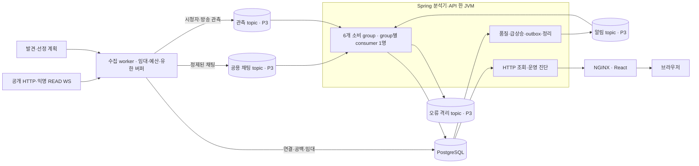
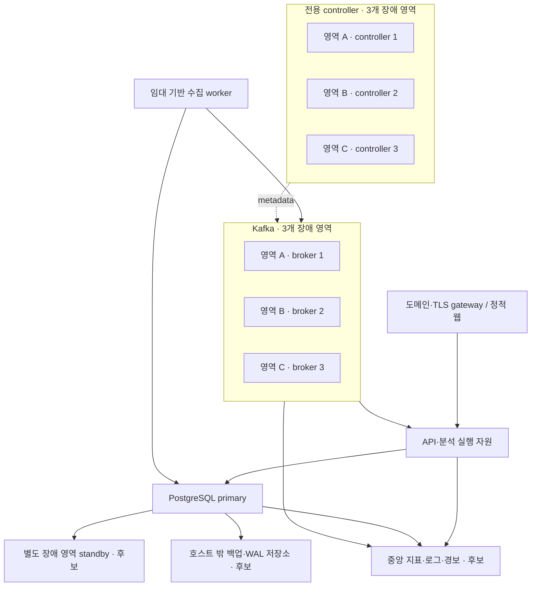

# 현재 인프라 아키텍처와 운영 전 결정

2026-10-27 · #65 재검증 반영 · [#67](https://github.com/joejaeyoung/jigeumini/issues/67) · F12/F13/F15/F16 → T08/T13/T14/T15/T16.
구조 초안의 코드 기준은 `6e0e8b2`, 후속 용량은 #65의 실행 commit별 근거를 따른다. 현재 작업 상태는 [STATUS](../STATUS.md)에 둔다.

## 무엇까지 나왔는가

**데이터 흐름·배포 패키지·Kafka HA 계약·백업 복원 절차는 있다. 외부 운영 인스턴스·저장 용량·월 비용과 서비스 전체 HA는 아직 확정되지 않았다.** [초기 아키텍처](ARCHITECTURE.md)는 구현 전 기록이며 partition6/독립 실행 프로필 등 현재와 다른 초안이 포함돼 있다.

## 현재 구현·로컬 배치

- 채팅 topic은 방송별로 만들지 않는다. 현재 key는 channelId/P3이다. ranking/trend/categories/reports가 채팅을, observations/categories/reports가 관측을, notifications가 알림을 읽는다. 총6개 group·입력 관계8개·진행 위치24개다.
- [Compose](../../deploy/compose.yaml)는 웹1·분석기/API1·PG1·combined Kafka1/RF1·명시 migration이다. fleet는 같은 서버 이미지의 별도 진입점이다.
- 비특권 이미지·비밀 파일·내부망·schema VALIDATE·source identity/offset 복구 guard가 있다. loopback 웹·내부 PLAINTEXT이며 운영 TLS/SASL·중앙 경보를 설치한 구성은 아니다. [실행·복구 계약](../../deploy/README.md).
- 공식 앱 등록은 익명 READ 경로의 전제가 아니다. 공개 목록 cursor 순회는 [조사](../research/CHZZK_PUBLIC_CATALOG.md)했고 제품 어댑터·장기 quota/범위 검증이 남는다. #47은 공식 인증 경로 선택 시 검증이다. 공개 live 검증 상한3개를 합성 부하 측정으로 변경하지 않는다.

## 운영 HA 배치 후보

Kafka는 RF3/minISR2/acks=all, unclean=false, 프로젝트의 ELR1 계약이다. controller 과반수와 데이터 ISR는 별개다. 한 영역 손실 시 남은 영역의 처리·저장·복구 부하를 따로 시험한다. [HA 계약](../pipeline/KAFKA_HA.md), [로컬 장애](../pipeline/KAFKA_HA_VERIFICATION.md), [디스크 손실](../pipeline/KAFKA_DISK_LOSS_VERIFICATION.md).

여섯 Kafka 프로세스가 여섯 VM 확정을 뜻하지는 않는다. 역할별 자원·재시작 경계와 관리형 선택은 공급자·예산에 따라 정한다. Kafka HA만으로 서비스 전체 HA가 완성되지는 않는다. 현재 API/분석기1·PG1은 단일 장애 지점이다. PG standby/자동 전환, API 조회 역할 분리·다중 인스턴스, scheduler 소유권/관측 집계와 전체 DB pool 예산은 추가 설계·검증이 필요하다. API를 복제하면 소비자와 scheduler도 함께 복제된다.

관리형 선택 시 공급자의 복제/백업 책임과 프로젝트의 Kafka 버전·ELR·인증·topic 정책·복원 검사 호환성을 확인한다. 공급자/SKU/리전은 미확정이다. [운영안·비용 항목](../DEPLOYMENT_OPERATIONS.md), [공식 조사](../research/KAFKA_DEPLOYMENT.md).

## 용량 설계의 기준

| 근거 | 확인 범위 | 운영 산정 의미 |
|---|---|---|
| 600채널 저부하 반복/5분 통과·1,000채널 실패 | collector/probe Xmx384MiB·container640MiB·전체100건/s/API10/s 합성 WS | [#65 비용·경계 검증](../PROJECTION_PERFORMANCE_VERIFICATION.md). 1,000은 readiness/watermark 실패, 정확한 최대·인기 방송 수용량 미확정 |
| 100채널·총500건/s·API10요청/s 재통과 | 1KiB 합성 WS·80% 편향·fresh DB·5분·P3/RF1 | 기존 복합 비교 후보를 유지. 실원천/fleet/HA와 장기 DB 검증 필요 |
| 100채널·총1,000건/s·API10요청/s 단회 통과 | 1KiB·80% 편향·30초 준비+240초 측정 | 상향 비교 근거이며 운영 최대나 안정 상한으로 채택하지 않음 |
| 균등2,000건/s 120초·DB2CPU의3,000건/s 60초 형식 통과 | 20채널, category/report lag 증가 | 지속 처리량으로 채택하지 않음. 분석기/API JVM2CPU·Kafka2CPU 단회도 운영 SKU 산정 근거로 부족 |
| 약1.45~1.55KB/고유 채팅 증가 | #62의 짧은 혼합 입력·fresh DB | 기간을 곱한 값은 추정. #65 뒤 최신 schema·장기 DB·WAL/replica/백업/정리 포함 실측 필요 |

[용량 경계](../CAPACITY_VERIFICATION.md)의 Docker VM8CPU·약7.65GiB는 비교 환경이다. 제품 container 한도 합계4.5CPU·2,496MiB는 별도 합성 원천과 OS/cache/운영 여유를 제외하며 운영 VM 추천 사양이 아니다. 단순 bucket 샤딩 실험의 개선율을 이 전체 제품 후보에 곱하지 않는다.

저장은 `입력률 × 압축 후 실제 bytes × 보존초 × RF + index/segment/복구 여유`로 계산한다. DB/WAL/standby/백업은 별도다. 현재256MiB/partition은 시간24h보다 먼저 삭제를 유발할 수 있어 복구 창을 보장하지 않는다. 샤딩은 총입력·RF를 줄이지 않으며 partial bucket은 DB 행/인덱스를 늘릴 수 있다.

## 운영 확정까지 남은 항목

| 항목 | 다음 결정·검증 | 추적 |
|---|---|---|
| hot 방송 샤딩 | #67 단순 bucket 실제 분산 대조 완료. 전체 제품 품질·관측·replay·전환과 지속 부하 검증 | [도입 검토](../pipeline/SHARDING_REVIEW.md), [#68](https://github.com/joejaeyoung/jigeumini/issues/68), [#65](https://github.com/joejaeyoung/jigeumini/issues/65) |
| 저장·보존/복구 창 | dedup/replay 하한을 지키는 유한 정리, 장기 DB·Kafka 증가/삭제량 | [#63](https://github.com/joejaeyoung/jigeumini/issues/63) |
| 수집 worker 수 | #64 버퍼·종료 개선 검증.후속 #65의600 저부하와100 복합을 구분하고 fleet/실원천 비용·실패 여유를 확인한 뒤 worker 수 결정 | [수집 메모리 검증](../COLLECTOR_MEMORY_VERIFICATION.md), [#64](https://github.com/joejaeyoung/jigeumini/issues/64) |
| 처리 자원 | SQL 호출·관측 색인 개선 및 계측/CPU 대조 완료. 실제 GC는 Serial이며 API 증설은 6개 소비 group을 포함한 전체 JVM에 적용. 장기 DB와 외부 환경에서 재산정 | [#65](https://github.com/joejaeyoung/jigeumini/issues/65) |
| 실제 장애 영역 | 계정/리전/AZ/예산/정리 조건 뒤 정상·영역 장애·복귀 대조 | [#48](https://github.com/joejaeyoung/jigeumini/issues/48) |
| 외부 운영 | 목표 부하/SLO/RPO/RTO, 공급자/SKU/월견적, 도메인/TLS, Kafka 인증·비밀 회전·중앙 경보·외부 백업 복원, PG 전환·앱 가용성 | [#49](https://github.com/joejaeyoung/jigeumini/issues/49) |

남은 로컬 구현·측정은 외부 계정 없이 진행할 수 있다. 유료 자원 생성·main 릴리스는 대상과 비용 조건이 준비된 별도 실행이다. 이번 검토에서 외부 인프라를 생성하지 않았다.
