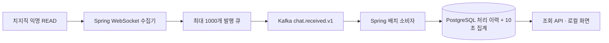

# M1 — 채팅 수집부터 집계까지

2026-10-25 · `feat/chat-pipeline`

Spring 수집기에서 치지직 공개 채팅 발생 이벤트를 Kafka로 보내고, 별도 Spring 분석기가 PostgreSQL에 10초 단위로 집계한다. 채팅 원문·닉네임·사용자 ID는 Kafka나 DB에 저장하지 않는다.



## 실행

Java 21, Python 3, curl, Docker Compose가 필요하다. 저장소 루트에서:

```bash
./scripts/infra up
./scripts/check
./scripts/integration

# 터미널 A: 새 consumer group의 최초 실행에서만 earliest를 명시한다.
./scripts/pipeline analyzer --pipeline.offset-reset=earliest
# 이후 재시작은 아래 명령. 저장된 offset이 없거나 retention 밖이면 자동 이동하지 않는다. 최초 earliest 실행은 입력이 없는 partition의 시작 offset도 기록한다.
# ./scripts/pipeline analyzer

# 터미널 B: 현재 공개 방송 중인 채널을 선택한다.
./scripts/discover
./scripts/pipeline collector <채널ID> 120s 60s

curl --fail http://127.0.0.1:18080/api/status
curl --fail 'http://127.0.0.1:18080/api/buckets?seconds=300'
```

화면: http://127.0.0.1:18080/ . 분석기는 Ctrl+C로 종료한다. 수집기는 지정 기간 후 종료한다.
`./scripts/infra down`은 이 Compose 프로젝트의 컨테이너만 내리고 named volume은 보존한다.
기존 gromo 컨테이너와 별개다. 로컬 Kafka `127.0.0.1:19092`, DB `127.0.0.1:15432`, 조회 `127.0.0.1:18080`을 사용한다.
Compose의 DB 계정은 로컬 개발 전용이다. 앱 설정은 `PIPELINE_JDBC_URL`, `PIPELINE_DB_USER`, `PIPELINE_DB_PASSWORD`, `PIPELINE_BOOTSTRAP_SERVERS`로 재정의할 수 있다.

스크립트는 빌드 JAR를 `work/runtime/`의 실행별 복사본으로 실행한다. 다른 터미널의 재빌드가 실행 중 JAR를 덮어쓰지 않는다. 복사본은 프로세스를 모두 종료한 뒤 정리할 수 있다.
기존 `./scripts/poc`는 Kafka·DB 없이 수신만 검사한다.

## M2 품질·독립 분석 확장

기존 채팅 이벤트의 ledger·bucket 원자 반영 계약은 유지한다. analyzer에 별도 trend consumer group과 ledger/bucket, 5초 end-offset/poll 관측, 완료 구간 평가 scheduler를 추가했다. 첫 그룹 초기화는 [루트 README](../../README.md), 상태·API·제외·정정 규칙은 [품질 계약](../api/QUALITY_RANKINGS.md)을 따른다. V2 migration은 수집 관측·snapshot·급상승 상태 테이블만 추가한다. 아래 M1 표는 첫 수직 구현의 범위를 설명하며 현재 추가 범위는 해당 품질 계약을 참고한다.

## 고정 입력 재처리 확장

[재처리 계약](REPLAY.md)의 로컬 CLI는 V4 작업 상태와 `replay/<UUID>` namespace를 사용한다. 운영 offset을 커밋하거나 순위·급상승을 재발행하지 않는다. M2의 V3는 창 종료 후 버퍼 표본을 짧게 보존하는 migration이다. 아래 M1 표는 최초 수직 구현의 범위이며 현재 재처리는 별도 계약을 따른다.

## 알림 확장

V6는 확정 spike와 같은 트랜잭션의 outbox, Kafka ACK 뒤 전달 완료, 별도 알림 group과 멱등 피드를 추가한다. [알림 계약](NOTIFICATIONS.md)을 따른다.

## 시청자 관측 확장

V7은 별도 `broadcast.observed.v1` 이력과 독립 consumer/DB 진행 위치·7일 정리를 추가한다. [시청자 관측·채팅 비교 계약](../api/OBSERVATIONS.md)을 따른다. 모든 공통 토픽 초기화는 cleanup.policy=delete를 명시·검사하며 compact 설정의 기존 토픽은 변경 없이 거부한다.

## 카테고리 반응 확장

V8의 독립 category group은 채팅·관측을 시각 기준으로 결합하며 자체 ledger/bucket/progress와 지연 보정을 저장한다. [카테고리 계약](../api/CATEGORIES.md)을 따른다.

## 방송 리포트 확장

V9의 독립 report group은 같은 두 입력에서 관측 세션·별칭·채팅 귀속·요약을 만든다. [리포트 계약](../api/REPORTS.md)의 DB 원자 보정·품질·7일 종료 기록 정리와 active 보호를 따른다.

## 저장과 처리 계약

아래는 M1 기준선이다. 현재 analyzer의 영구 오류 격리·품질 표시·진단은 [M3 DLQ 계약](DLQ.md)을 따른다. DB 성공 후 BATCH offset commit 경계는 유지하며, M1의 전체 배치 차단 정책은 안전한 격리 후 진행으로 확장했다.

- `chat.received.v1`: 3 partitions, 개발용 RF=1, key=`channelId`, timestamp=`receivedAt`의 epoch milliseconds, CreateTime 정책.
- Kafka 보존 설정은 시간 24h, partition당 256MiB, segment 32MiB다. segment 단위 삭제이므로 정확한 시각·용량 상한이나 24h 전체 가용성을 보장하지 않는다.
- 모든 토픽 초기화에서 생성 응답 뒤 토픽·설정 조회의 `UnknownTopicOrPartitionException`만 50ms 간격으로 재시도한다. 두 조회·재시도는 공통10초 기한을 쓰고, 생성 요청은 별도10초·Admin 종료는1초 상한이다. 권한 오류·다른 예외·partition 수/시각 설정 불일치는 즉시 실패하며 기존 토픽 설정을 바꾸지 않는다. [생성 후 조회 준비 계약·검증](TOPIC_READINESS.md)을 따른다.
- `acks=all`, idempotent producer, 연결당 in-flight request=1. #27의 [유한 비동기 발행](PUBLISHER.md)은 전용 dispatcher와 앱 ACK 대기 창64를 사용한다. Kafka client는 delivery timeout 10초 안에서 같은 record를 재시도한다.
- 발행 큐는 미확인 in-flight를 포함해 기본·최대1,000개, 채널별 기본500개, 이벤트당16KiB다. payload 상한은 약16MiB이고 객체 overhead는 별도다. 대기 채널을 한 건씩 순환 배분한다.
- frame 전체를 담을 수 없으면 전부 거절한다. 채널 한도는 그 채널, 전역 한도·발행 오류는 전체 수집을 중단한다. `rejected`, `unconfirmed`와 채널별 진단을 결과에 남긴다. 종료 drain은 최대10초며 종료 결과는 늦은 ACK에도 고정한다. 메모리 버퍼의 강제 종료·전원 손실은 복원하지 않는다.
- 수집기 성공 결과의 `delivery.complete`는 Kafka ACK까지 의미한다. DB 반영은 `/api/status` 또는 아래 대조 스크립트로 별도 확인한다.

소비자는 `max.poll.records=200`, auto commit=false, AckMode.BATCH, sync commit을 사용한다. 한 poll의 이벤트를 검증한 뒤 아래 작업을 한 PostgreSQL 트랜잭션에서 수행하고, commit이 끝나야 listener가 반환한다.

1. 배치 안의 같은 eventId를 제거한다. 같은 ID에 다른 payload면 전체 배치를 실패 처리한다.
2. `processed_event`에 `(projection, run_id, event_id)`를 삽입한다. conflict가 있으면 정규화 payload hash를 비교한다.
3. 새로 삽입한 이벤트만 channel/eventTime의 10초 bucket으로 합산하여 UPSERT한다.
4. 처리한 partition의 `next_resolved_offset`을 기록한다. 이 DB 값은 Kafka group offset을 대체하지 않는다.

DB commit 직후 프로세스가 죽으면 Kafka가 이벤트를 다시 전달한다. ledger가 이미 존재하므로 집계를 재증가시키지 않는다. 원천 서버가 같은 채팅을 새 이벤트로 보내는 중복은 제거하지 않는다.

스키마는 Flyway `V1__chat_projection.sql`로 관리한다. `processed_event`, `chat_bucket_10s`, `projection_progress`와 Flyway 이력만 사용한다. 기본 namespace는 `ranking/live-v1`이다. 단순 조회에서는 ledger·bucket 총합을 한 SQL snapshot으로 읽는다.

## 오류와 조회

DB 오류 등 listener 예외는 1초 간격으로 전체 batch를 무제한 재시도한다. 실패 record를 건너뛰는 recoverer는 없다. 계약 위반도 offset을 진행하지 않고 `/api/status`에 `BLOCKED_INVALID_EVENT`로 표시한다. 운영 DLQ·격리 후 진행 절차는 M3 범위다. 원본 메시지를 로그에 넣지 않는다.

DB pool은 최대 4개, 연결 대기 3초, socket timeout 10초, transaction timeout 20초, statement timeout 5초, lock timeout 3초다. `WAITING_FOR_EVENTS`는 partition 할당은 됐지만 아직 성공 batch가 없는 상태다. `RUNNING`도 원천 수집의 생존·전체 입력의 completeness·실시간 lag를 증명하지 않는다.

- `/api/status`: ledger/bucket 총합, 소비 상태, DB 진행 offset.
- `/api/buckets?seconds=300&channelId=...`: 최근 10~3,600초의 10초 bucket. seconds는 10의 배수이며 channelId 생략 시 수집한 전체 채널이다.
- 조회에는 진행 중인 bucket이 포함된다. coverage를 계산하지 않으므로 모든 응답에 `coverageMeasured=false`를 둔다.
- 화면은 5초마다 갱신하며 채널별 최근 5분 합계를 보여준다. 원천 전체 방송 순위나 완전한 수집률을 뜻하지 않는다. 빈 데이터도 정상 수집 0건이라고 단정하지 않는다.

## HLD 대비 이번 구현 범위

[HLD](../design/HLD.md)는 전체 목표 설계이며 M1에서 모두 구현하지 않는다.

| 목표 설계 | M1에서 구현한 범위 |
|---|---|
| 최대 20개 채널, collector 상태·gap·coverage | 기존 PoC의 최대 3개·30분 제한 유지. 한 공개 채널로 수직 경로 검증 |
| 채널별·전역 byte/count buffer, 독립 발행 | 더 작은 전역 1,000개 큐와 단일 ACK worker. 고부하 처리량 미검증 |
| bulk ledger insert + bucket UPSERT | ledger는 이벤트별 INSERT, 새 이벤트의 bucket은 배치 합산. 성능 최적화 전 |
| invalid 이벤트 DLQ 후 진행 | DLQ 없이 배치 재시도·오류 상태 표시. 잘못된 입력은 처리 진행을 막음 |
| 72h ledger, 7일 bucket 자동 정리 | 삭제 작업 미구현. 자동 삭제하지 않으므로 장기 운영 전 용량 정책 필요 |
| start offset을 관리 절차로 지정 | 기본 none. 빈 로컬 그룹의 최초 기동만 명시적으로 earliest 허용 |
| ranking/trend 독립 분석, snapshot, replay | ranking namespace의 기본 bucket·조회만 구현. 독립 소비·순위 snapshot·replay는 후속 |

## 재현 검증

`./scripts/check`: 실방송·Docker 없이 프로토콜, HTTP/WS fixture, 이벤트 계약, 발행 큐 경계 검사.
`./scripts/integration`: 실제 로컬 Kafka·PostgreSQL에서 매 테스트마다 UUID topic/group/schema를 만들고 해당 자원만 정리한다. Docker 서비스는 유지한다.

통합 검증은 중복 전달, 시각 bucket 경계, SQL rollback, 같은 ID의 내용 충돌, 실제 발행·소비·offset, DB 오류 회복, malformed 입력의 진행 차단, DB commit 직후 별도 JVM 강제 종료·재시작을 포함한다.
실방송 전후 대조는 다른 생산자가 없는 로컬 namespace에서 다음과 같이 한다.

```bash
curl --fail http://127.0.0.1:18080/api/status > work/before.json
./scripts/pipeline collector <채널ID> 120s 60s
# 수집 종료 로그의 report 경로를 사용한다.
./scripts/verify-pipeline work/before.json work/pipeline-<실행ID>.json work/reconciliation.json
```

실방송 검증과 자동 테스트의 결과는 [검증 기록](VERIFICATION.md)에 구분한다.

## 기술 근거

- [Spring Kafka listener container와 offset 처리](https://docs.spring.io/spring-kafka/reference/4.0/kafka/receiving-messages/message-listener-container.html)
- [Spring Kafka 배치 오류 처리](https://docs.spring.io/spring-kafka/reference/4.0/kafka/annotation-error-handling.html)
- [PostgreSQL INSERT / ON CONFLICT](https://www.postgresql.org/docs/16/sql-insert.html)
- [Apache Kafka Docker 배포](https://kafka.apache.org/41/getting-started/docker/)

## 후속 보존 계약

이 문서의 M1 당시 자동 정리 미구현 항목은 #63의 [보존 계약](RETENTION.md)으로 갱신한다. ledger72시간·bucket8일의 단조 하한을 적용하며 원천 identity/offset은 유지한다. 현재 완료 여부와 검증 근거는 STATUS를 따른다.
